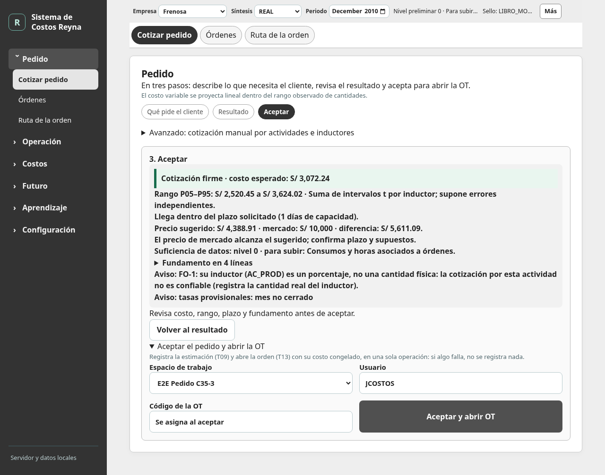

# C35-4 · Manual y capturas

Base: rama apilada `codex/C35-4` sobre `codex/C35-3` (`ba16ac5`).

## Cambios

- El manual describe los seis destinos del menú y el flujo Pedido en tres pasos. El conteo aumentó de 1.021 a 1.070 palabras: **49 palabras netas**, por debajo del máximo de 150.
- Se guardaron capturas nuevas del menú y de la pantalla Pedido desde la E2E propia de Chromium:
  - [Menú de seis destinos](C35_4_MENU.png)
  - [Pedido: resultado revisado antes de aceptar](C35_4_PEDIDO.png)

## Estado

Las capturas se generaron con el libro Frenosa copiado en un espacio temporal y una OT de prueba; no se alteró el libro fuente. C35-4 no cambia código ni cálculo. La compuerta completa C35-3 dio ROJA (65 pasaron, 1 falló en la prueba de interacción C26); C35-4 está apilada sobre esa rama y no tiene compuerta ni PR propios aún. Las pruebas propias de C35-3 que generaron las capturas pasaron (5/5). La decisión requerida para adaptar las E2E heredadas consta en `ordenes/RESPUESTAS_CODEX_24NOV.md`.

