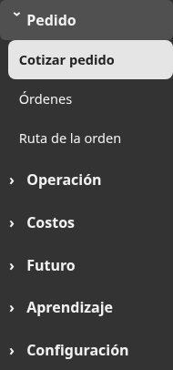

# C35-4 · Manual y capturas

Base: rama apilada `codex/C35-4` sobre `codex/C35-3` (`93f4bc9`).

## Cambios

- El manual describe los seis destinos del menú y el flujo Pedido en tres pasos. El conteo aumentó de 1.021 a 1.070 palabras: **49 palabras netas**, por debajo del máximo de 150.
- Se guardaron capturas nuevas del menú y de la pantalla Pedido desde la E2E propia de Chromium:
  - [Menú de seis destinos](C35_4_MENU.png)
  - [Pedido: resultado revisado antes de aceptar](C35_4_PEDIDO.png)
- La medición de cabecera y el recorrido de 26 pantallas siguen en [C35-2](C35_2_CABECERA.md) y [C35-1](C35_1_NAVEGACION_TABS.md), respectivamente.

## Estado

Las capturas se generaron con el libro Frenosa copiado en un espacio temporal y una OT de prueba; no se alteró el libro fuente. C35-4 no cambia código ni cálculo. C35-3 ya pasó su compuerta completa (569 pruebas; contrato válido) después de la decisión del dueño del 28-nov. C35-4 está apilada sobre `codex/C35-3`; su compuerta propia se ejecutará antes de abrir el PR. Las pruebas focalizadas del Pedido pasan (13/13).

